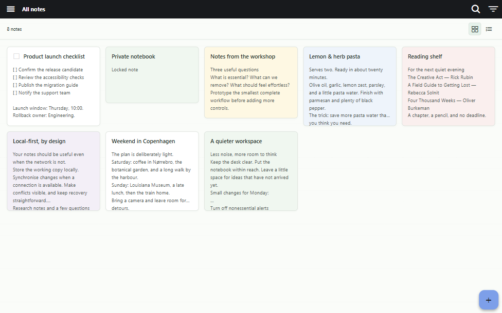
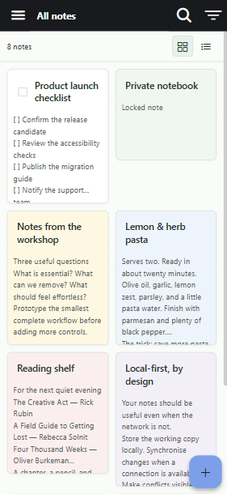

# Joplin Self-hosted Web

An unofficial, web-only deployment of the original Joplin Web App, with a same-origin proxy to your existing self-hosted Joplin Server. No desktop app, Joplin Cloud account, or native mobile project is needed. This is a deployment distribution of the upstream UI, not a rewritten note viewer. Not affiliated with Joplin or JOPLIN SAS.

The note list includes a responsive, Keep-inspired card view with local content excerpts and a compact-list toggle. Opening notes, editing, selection, to-do controls, and synchronisation still use Joplin's original components and models. Locked and encrypted note bodies are not shown in previews.

The official hosted web app deliberately limits sync choices on `https://app.joplincloud.com`. On your own origin, its existing Joplin Server sync target is available. This repository includes the extracted browser build, so deployment does not rebuild the Joplin monorepo.

**Important:** In the web app's synchronisation settings, use the **web app URL followed by `/joplin`**, not your backend server URL. The backend can remain HTTP while the web app uses HTTPS. See [Configure Synchronisation](#configure-synchronisation) below.

## Preview





Screenshots use disposable sample notes, not a real account. Cards show text excerpts without loading preview images or executing note HTML. Use the grid/list buttons to switch layouts; your choice is remembered in that browser. Click a title or excerpt to open the original editor. Existing search, notebooks, tags, and to-do controls remain available.

## Quick Start

You need an existing **Joplin Server account**, a Linux host with **Docker Engine and Docker Compose v2**, and Git. This installs only the web frontend, not Joplin Server. No Node.js installation or source build is required on the deployment host.

For a private LAN, replace the example IP and backend address with yours:

```sh
git clone https://github.com/Deckard-Li/joplin-self-hosted-web.git
cd joplin-self-hosted-web
sh tools/deploy.sh lan 192.168.1.20 http://192.168.1.20:22300 8443
```

1. Trust the generated `joplin-web-lan-root.crt` on every browser device using the [certificate instructions](#one-command-https-setup). Only trust a certificate transferred securely from your own host; do not bypass browser warnings.
2. Open **`https://192.168.1.20:8443`**, substituting your host and port. The installer prints the exact address.
3. Open **Configuration > Synchronisation**, choose **Joplin Server**, and set its URL to **`https://192.168.1.20:8443/joplin`**, not the backend URL. Enter your existing account credentials and synchronise.
4. Your notebooks and notes appear after sync. The card view is enabled by default.

Use `sudo sh` if your Linux user does not have Docker access. Allow your chosen HTTPS port through the host firewall; the installer does not change firewall rules. The backend must be reachable from inside Docker. For public HTTPS without certificate imports, see [One-command HTTPS Setup](#one-command-https-setup).

To update an existing installer-managed deployment without deleting notes or certificate trust:

```sh
git pull --ff-only
sh tools/deploy.sh lan 192.168.1.20 http://192.168.1.20:22300 8443
```

Use the same host, port, and deployment mode as before; public deployments should rerun their `public` command instead. Keep `caddy_data` and do not uninstall before updating. Reload the web app after the update; changing its origin creates a separate browser-local profile.

## Deploy With Docker

### One-command HTTPS Setup

Install Docker Engine with Docker Compose v2 on a Linux deployment host, clone this repository, and run one of these commands from its directory. No Node.js installation or manual Caddy edits are needed. Use `sudo sh` instead of `sh` if your user does not have Docker access.

For a private LAN, supply the host's IPv4 address or DNS hostname, your existing Joplin Server URL, and optionally an available HTTPS port:

```sh
sh tools/deploy.sh lan 192.168.1.20 http://192.168.1.20:22300 8443
```

For public HTTPS, supply a real DNS hostname pointing to this host and make ports 80 and 443 reachable:

```sh
sh tools/deploy.sh public notes.example.com https://joplin.example.com
```

Replace these example addresses with your deployment's addresses. The command builds and starts the original web app, recreates the chosen HTTPS proxy, saves settings in `.env.deploy`, and prints the exact web and synchronisation URLs. It stops the alternative HTTPS proxy when switching modes. The underlying HTTP web port is restricted to the Docker host's loopback interface. Set `WEB_PORT` before running the command if another application already uses port 8080. The backend URL must be reachable from inside Docker; `localhost` does not refer to the host.

**Public HTTPS needs no certificate import. Private LAN HTTPS requires a one-time trust import on every client device.** The LAN command automatically exports `joplin-web-lan-root.crt`. Transfer only that public certificate securely from your own host to the client, then run this on Windows in the certificate's directory:

```powershell
certutil -user -addstore Root .\joplin-web-lan-root.crt
```

On Ubuntu clients, install the public root with:

```sh
sudo cp ./joplin-web-lan-root.crt /usr/local/share/ca-certificates/joplin-web-lan-root.crt
sudo update-ca-certificates
```

Trust is needed on the device running the browser, not just the Docker server. Browsers with a separate certificate store may need a separate import. Restart the browser after importing, then open the printed HTTPS URL without bypassing warnings. A private CA cannot safely make other devices trust it automatically. For deployments where client imports are unacceptable, use public HTTPS or your organisation's already-trusted HTTPS proxy.

To update or reinstall after removing Docker images, run `git pull` and rerun your setup command. **Keep the `caddy_data` volume:** it retains the CA, so updates and image removal do not require another trust import. A new deployment with a new CA requires its own trust import. No fixed IP is embedded in the configuration; `WEB_DOMAIN` controls both the certificate and the fallback for clients that omit TLS SNI.

### Configure Synchronisation

The deployment backend URL and the URL entered inside the web app are **different**. For example:

| Where | URL |
| --- | --- |
| Deployment `JOPLIN_SERVER_URL` (your existing backend) | `http://192.168.1.20:22300` |
| Browser address (the web app) | `https://192.168.1.20:8443` |
| Joplin Server URL inside the web app | **`https://192.168.1.20:8443/joplin`** |

Replace the example host and ports with yours. Open **Configuration > Synchronisation**, select **Joplin Server**, enter the web app's URL followed by `/joplin`, and enter your existing Joplin Server account credentials. Use exactly the same scheme, hostname/IP, and port as the browser address. The setup command prints this sync URL. Account credentials are not passed to the setup command or stored in deployment files.

Do **not** enter the HTTP backend URL inside the HTTPS web app. The browser can block that direct request as mixed content and report **Failed to fetch**. Instead, the browser calls the HTTPS same-origin `/joplin/api/` proxy, and the web container connects to your configured backend over HTTP or HTTPS. An HTTP backend does not need to be converted to HTTPS for this setup to work, although HTTP traffic between the container and backend is unencrypted.

**If synchronisation reports Failed to fetch:** first check the in-app URL above, then open the web app's URL followed by `/joplin/api/ping` in the same browser, for example `https://192.168.1.20:8443/joplin/api/ping`.

- A successful JSON response confirms the proxy can reach that backend endpoint; it does not verify account credentials or complete synchronisation.
- A `502` response means the upstream connection failed. Check the deployment's backend URL and container connectivity; `localhost` inside Docker is not the Docker host.
- A certificate warning means client trust must be fixed. Import your deployment's LAN root on the browser device and restart the browser; do not bypass the warning.

Correcting the sync URL does not require uninstalling the app or clearing local note data.

### Manual Or Existing Reverse Proxy

1. Clone this repository and copy `.env.example` to `.env`.
2. Set `JOPLIN_SERVER_URL` to the base URL of your existing Joplin Server, including any reverse-proxy path prefix. The container must be able to reach this URL. `localhost` inside the container refers to the container, not your host.
3. Run `docker compose up --build -d`.
4. On the Docker host, open `http://localhost:8080`. For remote or LAN access, put an HTTPS reverse proxy in front of this web container; preserve the original `Host` header and forward every path, including `/joplin/`.

Manual deployment publishes the web port on all host interfaces at `WEB_PORT` (default `8080`). Restrict this port to your trusted LAN or reverse proxy with a firewall. If your reverse proxy runs directly on the Docker host, set `WEB_BIND=127.0.0.1` in `.env`. An HTTP backend such as `http://192.168.1.20:22300` is supported: the browser calls the web app's same-origin `/joplin/api/` proxy, and the container calls your server. **The frontend itself requires a secure browser context: HTTPS, or localhost for development. Plain HTTP on a LAN IP is not sufficient for the browser storage and service worker APIs.** HTTP between the web host and backend still exposes credentials and notes on that network; use HTTPS there too when possible.

When updating an existing deployment, run `git pull` followed by `docker compose up --build -d --force-recreate web` on the Docker host. Run `docker compose port web 8080` to verify that the published address is `0.0.0.0:<WEB_PORT>` (or its IPv6 equivalent), not `127.0.0.1`. `WEB_DOMAIN` configures Caddy's HTTPS site name; it does not control the web port binding.

An optional Caddy HTTPS service is included. Set `WEB_DOMAIN` to a domain pointing at this host, make ports 80 and 443 reachable and available, and run `docker compose --profile https up --build -d`. Caddy obtains and renews a public TLS certificate. If you already have a reverse proxy, use that instead and leave this profile disabled. An IP-only private LAN deployment needs a certificate trusted by your browsers; the included public-certificate configuration does not set up a private certificate authority.

## HTTPS On A Private LAN

The recommended setup is `sh tools/deploy.sh lan HOST JOPLIN_SERVER_URL [HTTPS_PORT]` above. The following steps are only for manual deployments using `.env`. For a deployment created by the setup command, add `--env-file .env.deploy` to subsequent `docker compose` commands so they use the saved settings.

Use the separate `lan-https` profile when accessing the app by a private IP or local hostname. In `.env`, set `WEB_DOMAIN` to the Docker host's LAN IP or hostname, without a scheme, port, or path (for example `192.168.1.20`), and set `LAN_HTTPS_PORT=8443` or another available port. Leave `JOPLIN_SERVER_URL` pointing to your existing backend. Do not enable the public `https` profile at the same time.

On the deployment machine, run:

```sh
git pull
docker compose --profile lan-https up --build -d web https-lan
docker compose --profile lan-https cp https-lan:/data/caddy/pki/authorities/local/root.crt ./joplin-web-lan-root.crt
```

Wait until Caddy has started before copying the certificate; `docker compose logs https-lan` shows any startup errors. Caddy creates and persists a private certificate authority in the `caddy_data` volume. Transfer only `joplin-web-lan-root.crt` securely from your own deployment host to each client device and explicitly trust it in the OS or browser's trusted root certificate store. For Windows, you can run `certutil -user -addstore Root .\joplin-web-lan-root.crt` yourself; browsers using their own certificate store may also need an import there. Never distribute the CA's private key or import a root from an untrusted source. Remove this trust when you no longer use the deployment.

Restart the browser and open `https://192.168.1.20:8443`, substituting your configured host and port. Do not use the old HTTP URL or merely bypass a certificate warning. In the browser console, `window.isSecureContext` and `window.crossOriginIsolated` should both be `true`. Keep the URL stable to preserve the browser's local note profile; changing from HTTP to HTTPS creates a new profile that needs to synchronise again. Configure the app's Joplin Server URL as `https://192.168.1.20:8443/joplin`.

## Uninstall Completely

Synchronise any browser-only changes before uninstalling. Removing this frontend does not delete notes, accounts, or resources from your separate Joplin Server.

First remove the imported LAN CA from **every client where you trusted it**, while you still have the exported public certificate available to identify it. On Windows, display its certificate hash:

```powershell
certutil -dump .\joplin-web-lan-root.crt
```

Use the exact `Cert Hash(sha1)` value to remove only this certificate from the current user's trusted root store:

```powershell
certutil -user -delstore Root YOUR_EXACT_CERTIFICATE_HASH
```

If you imported it into the Local Computer store instead, remove that exact certificate using `certlm.msc` with administrator permissions. Do not remove unrelated Caddy certificates. For Ubuntu clients where you followed the installation commands above:

```sh
sudo rm /usr/local/share/ca-certificates/joplin-web-lan-root.crt
sudo update-ca-certificates
```

Browsers with their own certificate stores require removal of the matching CA there too. Public HTTPS requires no imported root cleanup.

On every browser/device used with this app, remove site data for each app origin you used, including older HTTP addresses and changed hostnames or ports. In Edge DevTools, use **Application > Storage > Clear site data**, include storage and service workers, and unregister any remaining service worker under **Application > Service workers**. This removes local note copies, settings, session tokens, offline caches, and installed workers; uninstall an installed web app/PWA as well. Do not clear unrelated sites. Close the app's tabs afterwards.

Then run this from the deployment repository on the Docker host:

```sh
sudo sh tools/deploy.sh uninstall --confirm
```

The confirmation flag permanently removes this Compose project's containers (including stopped alternative HTTPS services), network, named CA/config volumes, and locally built web image. It also deletes `.env`, `.env.deploy`, and `joplin-web-lan-root.crt` in this repository. The CA private key is in the deleted volume, not installed into the host by the setup command. Uninstall still works if the generated environment file is missing. Keep the same repository directory and Compose project name used for installation; renamed directories or a changed `COMPOSE_PROJECT_NAME` identify a different project.

Afterwards, delete transferred/downloaded certificate copies and the repository folder if no longer needed. Any `.cache/` or `node_modules/` created during development is inside that folder. Remove only DNS/proxy/firewall rules you separately created for this app; the installer does not change host certificate stores, Docker installation, DNS, firewall rules, or system services.

**Shared Docker base images and build cache are deliberately retained.** Docker can retain cached build layers after image deletion; the uninstall command does not run global prune operations because those can affect other applications. It also cannot remove remote client trust, browser data, copies/backups, shell history, or your existing Joplin Server. There is no secure-erasure guarantee for deleted files or volumes. To retain certificate trust for a reinstall, use a normal Compose stop/down without `--volumes` instead of this uninstall command.

## Connect And Review Notes

1. Open the web app's settings and the Synchronisation section.
2. Choose **Joplin Server** as the synchronisation target.
3. Set **Joplin Server URL** to the web app's URL followed by `/joplin`, for example `https://notes.example.com/joplin` or `http://localhost:8080/joplin`. This is the proxy URL, not `JOPLIN_SERVER_URL` from `.env`.
4. Enter the same Joplin Server account used by the clipper, save the settings, and synchronise.
5. Open the notebook where you clipped your pages. Notes and attachments appear after the sync finishes.

This frontend does not replace Joplin Server or its database. Both the clipper and this web app use your existing server. The original web app stores a local copy of notes and settings in browser storage; synchronise before clearing that storage. Keep the frontend origin stable, since changing its hostname or port creates a separate browser profile.

## Run Without Docker

Install Node.js 22 or newer. There are no runtime npm dependencies.

```powershell
$env:JOPLIN_SERVER_URL = 'http://192.168.1.20:22300'
npm start
```

Open `http://localhost:8080`. On Linux/macOS, use `JOPLIN_SERVER_URL=http://192.168.1.20:22300 npm start`.

## Development And Upstream

Run `npm ci` and `npm test` to test the web host, HTTP proxy, protected previews, worker assets, and extraction hashes. `node tools/extract-web.mjs` refreshes browser assets from the official deployment and automatically reapplies the checked card-view customization; review and commit `web/` and `upstream-assets.json` together. Extraction parses HTML and JavaScript to discover runtime assets and records original/resulting hashes. One pinned addition to the application bundle's note-list renderer loads the included card script; worker bundles remain unchanged. Page titles, manifest branding, restricted app icons, and the web bootstrap are adapted, and development mode remains disabled. After editing `web/note-cards.js` or `web/note-cards.css`, run `node tools/customize-note-list.mjs` to refresh asset hashes. On Windows behind an enterprise HTTPS proxy, `node --use-system-ca tools/extract-web.mjs` uses trusted system certificates without disabling TLS checks. Delete the ignored `.cache/upstream/` directory before refreshing to a new upstream release; changed upstream module anchors require review, not a blind patch.

Upstream application source and build instructions: [laurent22/joplin](https://github.com/laurent22/joplin), especially `packages/app-mobile`, `packages/lib`, `packages/editor`, and `packages/renderer`. The original app is documented at [Joplin Web App](https://joplinapp.org/help/apps/web/). See `SOURCES.md` for the exact corresponding source revision, `NOTICE.md` for licensing and extraction scope, and `VERIFICATION.md` for completed and unverified checks.

## Security

Use HTTPS for public deployment, protect the browser profile, and expose only the web frontend through your reverse proxy. Never commit `.env` or put passwords in server URLs. The proxy has one operator-configured backend and is not an open proxy. Joplin's authentication and sync engine are retained; this host does not log request bodies or store your account credentials. This experimental deployment needs live-server testing before use with important accounts.